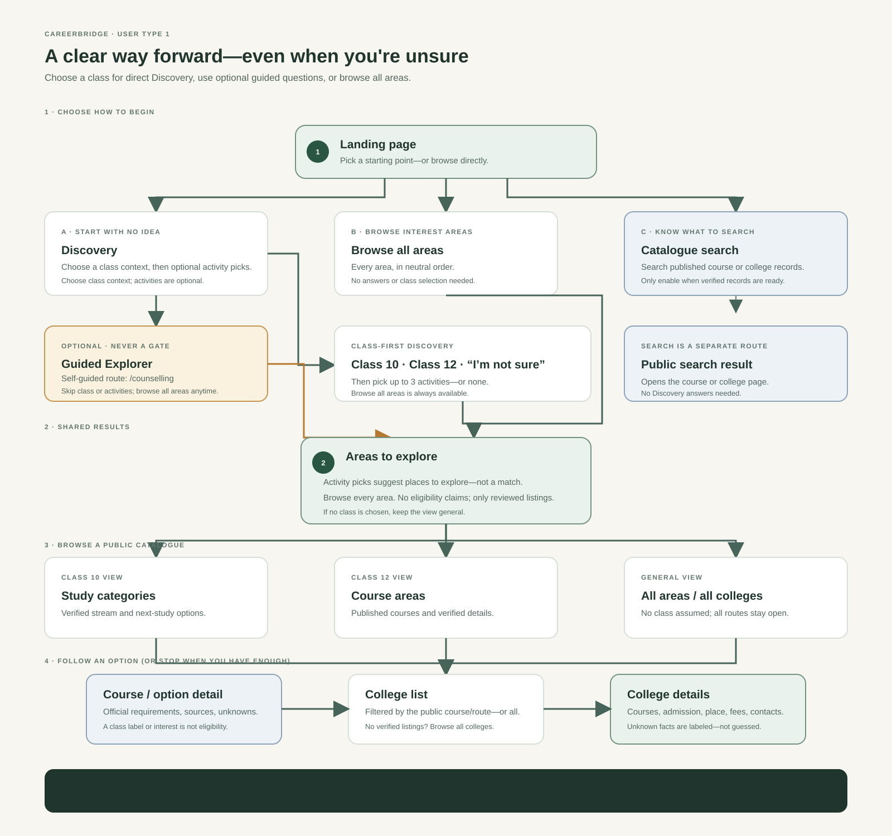

# CareerBridge Next — User Type 1: Complete Product Specification

**Target User:** Class 10 / Class 12 student in Nagaland (Northeast India) who has **no idea** what to do after school.  
**Status:** User-walkthrough reviewed product direction (v3.1; catalogue facts and privacy behavior require verification)  
**Scope:** Full end-to-end flow — Landing → Discovery / Guided Explorer → Class 10 & Class 12 paths → College Detail

---

## 1. User Profile

| Attribute | Detail |
|-----------|--------|
| **Name** | User Type 1 — "No Idea" Student |
| **Who** | Class 10 or Class 12 student, Nagaland / Northeast India |
| **Mindset** | "I don't know what to do after school. I don't know my strengths. I'm scared of picking wrong." |
| **Device** | Likely mobile phone, possibly shared computer at cyber café |
| **Constraints** | Minimal data collection. No account required to browse. No pressure to decide today. |

---

## 2. Guiding Principles

| Principle | Application |
|-----------|-------------|
| **Guide, don't decide** | No "top match," no rankings, no "you should be a X" language. Show broad areas first. |
| **One clear next action per page** | Each screen has an obvious way forward. Discovery asks for a class context before showing optional activities; "Browse all areas" always bypasses the questions. The core Class 10/12 path has up to 7 screens. |
| **Honest about uncertainty** | Fees, exams, scholarships, course availability, and eligibility show "not verified" where unknown. Never invent numbers or imply an unverified route is an admission guarantee. |
| **Always know where you are** | Journey pages provide a clear back action and a separate "Clear my choices" action. The labels explain whether choices are kept or removed. |
| **Mobile-first** | Thumb-friendly buttons, readable text, no horizontal scroll, minimal data usage. |
| **Guided Explorer is optional** | Discovery is the direct route; Guided Explorer is an optional step-by-step alternative from Discovery. Neither blocks browsing. It is not a human counsellor. |
| **Class 10 ≠ Class 12** | Separate paths after class selection. Different streams vs different course areas. |
| **Activity picks are explainable suggestions** | Use a curated, visible mapping; say "may connect." It is exploratory, not a match score or eligibility decision. Always offer all areas and pathways. |
| **Filters are reversible** | Changing a class or pick clears only incompatible downstream context, explains what changed, and preserves the student's activity answers. |
| **Uncertainty is a valid outcome** | A student may choose "I’m not sure" for class, skip activities, or browse all areas without creating a profile or being forced to confirm an interpretation. |

---

## 3. Complete Flow Diagram



**Download/view:** [USER_TYPE_1_FLOW.svg](./USER_TYPE_1_FLOW.svg)

**Core path:** Landing -> direct Discovery (choose Class 10, Class 12, or "I’m not sure" first; then optionally pick activities) -> shared Results -> study options (when verified catalogue content is available) -> public option/course detail -> College List -> College Detail. Students can instead browse all areas without answering questions. Guided Explorer is a distinct optional route: welcome -> skippable class context -> skippable activities -> the same Results; both routes preserve a neutral browse-all action. A class choice only organizes browsing; it never decides eligibility. Direct links to valid public content work without session state.

**Page count:** Up to 7 screens for the full class-specific path. General browse may be shorter; no screen exists solely to force a decision or confirm an invented profile.

### User-perspective walkthrough

| Student situation | What happens | Why they do not get stuck |
|-------------------|--------------|----------------------------|
| "I have no idea," chooses nothing | "Browse all areas" opens every area in neutral order without answers | Discovery's class-first path is optional; the browse-all bypass never requires a class or activity |
| Is unsure about their class | Selects "I’m not sure" to unlock optional activity picks and broad Results; no class is inferred | They can also bypass questions and browse all areas |
| Knows their class but no activity fits | Continues with no activity picks; Results stays broad and states that verified class-specific listings are not ready | No forced activity pick or fabricated catalogue |
| Opens a course, college, or area link directly | Requested public content loads without a session; an optional Discovery link is available | No forced restart and no guessed class |
| Finds no relevant course or college | Explain whether the catalogue has no verified entries or the request failed to load; offer all areas, unfiltered colleges, and retry where applicable | A missing result is not presented as an error or a dead end |
| Wants to change their mind or is using a shared device | "Back to Discovery" preserves choices; "Clear my choices" confirms, clears them, and returns to general Discovery | Back and clear have distinct, predictable effects |

**Release check:** Walk these cases on a small phone and keyboard before launch. Every screen must have a visible next action, a way back, and a route to browse all areas. Do not count a disabled or "Coming later" control as a working recovery.

---

## 4. Page-by-Page Specification

### 4.1 Landing Page (`/`)

**Purpose:** Let the student self-identify their entry point. No pressure.

**Content:**
1. **Hero headline:** "You don't need to have your whole future figured out."
2. **Sub-headline:** "CareerBridge helps you explore career and education options in Nagaland and the Northeast, at your own pace. No pressure to decide today."
3. **Three entry doors (equal size):**
   - **Door 1 (primary, highlighted):** "I have no idea where to start" — "Browse options with a few optional everyday-interest picks." → `/discover`
   - **Door 2:** "I have some idea of what I like" — "Browse every interest area." → `/discover/results` (opens all areas with neutral ordering)
   - **Door 3:** "I know exactly what I want to study" — "Browse or search courses and colleges." → `/catalogue`
4. **Trust strip (3 short reassurances):**
   - "No right answer required"
   - "Go at your own pace"
   - "Change direction later"
5. **Example box (optional):** A clearly labeled example of browsing, not a prediction or a stored profile.

**Student actions:** Door 1 starts Discovery; Door 2 opens all areas; Door 3 opens the public catalogue search. `/catalogue` must be a defined, working search/browse page for verified course and college records before the door is enabled. Exam search is out of MVP scope. If any destination is not ready, show a labeled "Coming later" state and keep Discovery available.
**System behavior:** No account required. Do not claim that nothing is remembered until storage and network behavior are verified.

**Do NOT include:** "Apply now," "Sign up," "Choose your career," specific job titles, salary promises.

---

### 4.1a Public Catalogue Search (`/catalogue`)

**Purpose:** Give students who already know a course or institution a direct, public way to find verified catalogue entries without completing Discovery.

**Content:** One search field for course or college names, plus browse links to all areas and `/colleges`. Results link to public course, area, or college pages. Do not include exam search in MVP.

**Behavior:** Search only the published catalogue; do not imply a result exists if it is not in the data. Empty search shows browsing links. `/catalogue?area=[area-slug]` filters by a public catalogue area; it does not contain a student's answer. No session state is required and no personalized ranking is applied.

**Release gate:** Door 3 stays visibly marked "Coming later" until this route searches verified course and college records.

---

### 4.2 Discovery Page (`/discover`) — Self-Guided Entry

**Purpose:** Help an unsure Class 10 or Class 12 student begin exploring without treating their choices as a test, recommendation, or eligibility check.

**URL:** `/discover`

**Layout — First: choose a browsing context**

Ask: **"Which class are you in now?"** The student must choose one option before the optional activities and primary action appear:

| Option | Behavior |
|--------|----------|
| **Class 10** | Opens the Class 10 browsing context; never implies eligibility |
| **Class 12** | Opens the Class 12 browsing context; never implies eligibility |
| **I’m not sure** | Opens broad browsing without guessing the student's class |

**Next: optional activity cards (8 everyday examples):** Show these only after a class option is selected. The student can pick up to 3, or none. A fourth selection is not added; show the inline message **"Choose up to 3 activities. You can change them anytime."** There is no separate "not sure about these" activity toggle—choosing none is already valid.

**Primary action:** Disabled until the student chooses Class 10, Class 12, or "I’m not sure." Use **"Show me options"** for Class 10/12 and **"Browse broadly"** for "I’m not sure."

**Always-available bypass:** Keep **"I’d rather browse all areas"** visible in the opening section. It opens `/discover/results/all#all-areas` without requiring class or activity answers and keeps existing choices available to edit.

**Guidance callout:** Clearly say this is not a test; class is only a browsing context; activities are optional starting points; and nothing determines eligibility.

**Results limitation:** Verified class-specific streams, courses, and college records are not yet available. State this plainly on Results; any mapped areas are broad editorial exploration prompts, not a class-specific catalogue.

**Accessibility and motion:** Use a native single-choice radio group with a correctly associated legend and helper text; make activity selection keyboard operable; honor `prefers-reduced-motion`.

---

### 4.3 Discovery Results Page (`/discover/results`)

**Purpose:** Show broad study areas that a student may explore based on optional activity picks. **No hidden algorithm, no usage-data claims, and no career assignment.**

**URL:** `/discover/results` (student answers are not placed in query parameters; public content slugs may appear on their own detail URLs).

**Curated mapping (activity → area):**

| Activity Pick | Mapped Area | Example Wording on Card |
|---------------|-------------|------------------------|
| Fixing things | Technology & Computing | "You said you like fixing things — this area may connect to repair and technical work." |
| Computers & phones | Technology & Computing | "You said you like working with computers — this area may connect to IT and digital work." |
| Helping people feel better | Health & Care | "You said you like helping people — this area may connect to care and health work." |
| Working outdoors | Nature & Fieldwork | "You said you like working outdoors — this area may connect to nature-based work." |
| Organising & planning | Business & Office | "You said you like organising — this area may connect to office and business work." |
| Drawing & making | Creative & Design | "You said you like drawing and making — this area may connect to creative work." |
| Working with numbers | Finance & Data | "You said you like working with numbers — this area may connect to finance and data work." |
| Teaching & explaining | Education & Social | "You said you like teaching — this area may connect to education work." |

**Mapping rules:**
- Every mapping is an editorial exploration prompt, not a verified qualification, admission route, or claim about outcomes. Label it "A place you could explore," and review it with educators before launch.
- State on the page: "These ideas help you browse; they do not tell you which courses you qualify for."
- Show the relationship from activity → broad area → available Class 10/12 options on the same card. Use only options that exist in the verified catalogue; if there is no verified connection, say so and keep the area browseable without a class-specific claim.
- For Class 10, show applicable next-study categories (including streams only where confirmed by the catalogue). For Class 12, show course categories from the catalogue. Do not show course titles, prerequisites, or eligibility based only on an interest.
- Every card includes "See study options" and the page has a prominent "Browse every area" action. These never clear activity picks.
- If no activity is selected or mapped, show all areas in neutral order and say "Browse all areas"; do not fabricate a starting picture.
- Render every distinct mapped area, not an arbitrary 2–3. Multiple picks may map to the same area; deduplicate areas and explain all relevant picks on that card.
- Class 10, Class 12, and general browse are visibly labeled. General browse never silently assumes a class.

**Area cards:**
- Area name
- One-sentence plain-language description
- "You picked [activity]. This is one area you could explore—not a prediction."
- "Options in this area:" verified public catalogue links grouped by Class 10, Class 12, or class not specified. A class choice can reorganize the view but never gates access.
- Button: "See study options" → `/catalogue?area=[area-slug]`. This is a public content filter, not an answer or personal profile. Show available catalogue entries grouped by Class 10, Class 12, or "class not specified"; never infer eligibility. If there are no verified entries for that area, show the honest no-listings state and recovery links below.
- Link: "See all areas" / "Change my picks"

**Bottom links:**
- "Browse every area" — opens the complete set in neutral order without clearing picks
- "Change my picks" — returns to Discovery with selections preserved
- "Help me look around" → Guided Explorer (`/counselling`)

**Area-to-path content table (editorial draft, not an eligibility map):**

| Area | Class 10: possible browse categories | Class 12: possible browse categories |
|------|--------------------------------------|--------------------------------------|
| Technology & Computing | Science; vocational/technical options where listed | Computing/IT degrees, diplomas, and skills courses where listed |
| Health & Care | Science; health-related vocational options where listed | Health-related degrees, diplomas, and skills courses where listed |
| Nature & Fieldwork | Science; agriculture/environment options where listed | Agriculture, environment, science, and related courses where listed |
| Business & Office | Commerce; vocational/business options where listed | Commerce/business, office, and related courses where listed |
| Creative & Design | Arts; design/vocational options where listed | Arts, design, media, and related courses where listed |
| Finance & Data | Commerce; mathematics-related options where listed | Commerce, finance, statistics, and data courses where listed |
| Education & Social | Arts; education/social options where listed | Education, social science, and related courses where listed |

These are broad editorial associations for navigation only—not claims that every listed category or course is available locally. Before publication, replace each category with actual catalogue entries and source links; omit any association that is not supported by reviewed content. A student may always browse every category regardless of their activity picks.

---

### 4.4 Class 10 Path — Stream Options (`/discover/streams`)

**Entry:** Student selected Class 10, or opened this public catalogue directly. No session state is required.

**URL:** `/discover/streams` (public catalogue content; no saved answer is required to open it).

**Header:** Back link → `/discover` | Title: "After Class 10, what would you like to study?"

**Study-category cards (equal weight):**

| Stream/category | What it means | Example subjects or learning focus |
|-----------------|--------------|-----------------------------------|
| Science | Science-focused study in the next stage | Show subjects only when verified for the institution/board |
| Arts / Humanities | Humanities and social-science-focused study | Show subjects only when verified for the institution/board |
| Commerce | Business, accounting, and economics-focused study | Show subjects only when verified for the institution/board |
| Vocational / Skill | Practical or occupational study options | Show actual options only when verified in the catalogue |

**Each card:** Name · plain-language description · verified subjects/options where available · "Possible areas to research" only when sourced · Button: "Explore this option." Do not imply that a stream guarantees entry to a course or job.

**Bottom links:** "Browse every option" and "I don't know my class" return to the general catalogue without clearing activity picks. The latter leads to `/discover/results` in general-browse mode.

---

### 4.5 Stream Detail (`/streams/[stream]`)

**Trigger:** Student clicked a stream card.

**URL:** `/streams/science` (or arts, commerce, vocational)

**Header:** Back link → `/discover/streams` | Title: "[Stream Name]"

**Content:** Verified next-study categories and course pages associated with this stream. Do not prescribe a career or assert eligibility unless current official requirements are cited.

| Study area | What to explore | Requirement source |
|------------|-----------------|-------------------|
| Example study area | Broad description, not a career assignment | Official course/admission source and checked date |

Each item links to public course details or the shared college list. Keep examples out of production until their actual local availability and requirements are verified.

**Rule:** No path is "better." Equal visual weight; alternatives remain available.

---

### 4.6 Class 12 Path — Course Areas (`/discover/courses`)

**Entry:** Student selected Class 12, or opened this public catalogue directly. No session state is required.

**URL:** `/discover/courses` (public catalogue content; no saved answer is required to open it).

**Header:** Back link → `/discover` | Title: "After Class 12, what kind of study interests you?"

**Course Area Cards:**

| Area | What it means | Catalogue content |
|------|--------------|-------------------|
| Diploma / Polytechnic | Practical or technical study | Actual listed diplomas and verified details |
| University degree | Academic study at a college/university | Actual listed degree courses and verified details |
| Skill training | Shorter occupational training | Actual listed courses and verified details |
| Professional study | Specialized study with defined requirements | Actual listed courses and official requirements |

**Each card:** Area name · plain-language description · actual listed courses · verified duration/admission details where available · Button: "See courses in this area." Do not infer eligibility from subjects or interest.

---

### 4.7 Course Area Detail (`/courses/[area]`)

**Trigger:** Student clicked a course area card.

**URL:** `/courses/diploma` (example)

**Header:** Back link → `/discover/courses` | Title: "[Area Name]"

**Content:** Actual course types in the catalogue, each with a link to its official source and the date checked:

| Course | Admission requirements | Duration | Institutions |
|--------|------------------------|----------|--------------|
| Verified course entry | Officially sourced; label unknowns | Officially sourced or "Not verified" | Verified listings only |

Each course type: Button "See colleges" · verification status and source.

Do not ship placeholder examples or present unverified course availability, exams, duration, or institution names as facts.

---

### 4.8 Shared College List Page (`/colleges?route=[route-slug]`)

**Trigger:** Student clicked "See colleges" on a public course/route page reached from either Discovery or Guided Explorer.

**URL:** `/colleges?route=[route-slug]`

**Header:** Back link → previous page | Title: "Colleges offering [Route Name]"

**College cards (list view):**

| Field | Content |
|-------|---------|
| College name | Verified institution name |
| Type badge | Verified institution type |
| District | Verified district/location |
| Course offered | Verified course name |
| Admission | Officially sourced requirements or "Not verified" |
| Fees | Course/year-specific source or "Not currently verified — check college prospectus" |
| Hostel | Verified information or omit / "Not verified" |
| Official website | Verified official link; opens safely in a new tab |

**Below list:** When the route is valid but no verified college entries are available, say "We don't have verified college listings for this option yet." Offer "Browse all colleges" → `/colleges` and "Browse all areas" → `/discover/results`. Do not imply that no colleges exist. If the list fails to load, show a separate error with "Try again" and the same browse links.

**One shared page for both Class 10 and Class 12 paths.** No separate duplicate list step.

---

### 4.9 College Detail Page (`/college/[code]`) — Final Page

**Entry:** Student clicked a college name from College List, or opened this public content URL directly.

**URL:** `/college/[code]`

**Header:** Back link → previous page | Title: College name | Subtitle: Type badge + district

**Sections (top section first — scannable basics):**

1. **Courses offered here** — Verified course list; never hide other courses based on session context
2. **Admission & eligibility** — One concise section for verified entry requirements, exams, dates, documents, and application cycle. Label unknown information "Not verified."
3. **Location** — District, verified address, map link if available
4. **Fees** — Scoped to specific course + academic year. If unknown: "Not currently verified — check college prospectus." Never show ₹0 or "free" if unknown.
5. **Official contact** — Verified website (new tab), phone, email if available

**Below (expandable/collapsible section):**
6. **Hostel & facilities** — Verified information only; label unknowns

**Verification rules:**
- Unknown data: "Not verified" with source/check date where available — never an unexplained "Not confirmed"
- Never hide urgent deadlines or unknown-data warnings behind expandable sections
- Never invent numbers
- Keep exam and admission details in the single Admission & eligibility section; do not repeat them in separate sections. Scholarship content is out of MVP scope.

**"What's next?" box:** Link to the official college/admission source when available. Do not prescribe actions tied to unverified exams or fees. Save actions are out of MVP scope.

---

### 4.10 Guided Explorer Page (`/counselling`) — Self-Guided Entry (Optional)

**Purpose:** A calmer, step-by-step alternative to Discovery. It asks only for browsing context and optional activities; it does not diagnose the student or create a career profile. **Not a human counsellor.**

**URL:** `/counselling`

**Entry points:** From Discovery ("Try Guided Explorer") or Results ("Help me look around").

**Page header:**
```
Guided Explorer
Self-guided browsing — no person involved. You can skip questions and browse all options.
```

**Persistence:** Seed the questions with existing choices from the current tab when available. Keep edits as an in-memory draft until the student continues to Results; leaving earlier leaves the previously saved choices unchanged. On continuing, store only the class context and activity picks in the existing tab-scoped `sessionStorage` state. Do not promise that answers are private or never reach a server; disclose hosting logs and analytics behavior before launch.

**Relationship to Discovery:** This is a separate, optional route. Direct Discovery keeps its class-first interaction; Guided Explorer makes both questions skippable. Class context only labels or organizes a browse view and never qualifies or excludes the student. Verified Class 10/12 catalogue records are not available in this MVP.

#### Step 1: Welcome

**Header:** Back to Discovery | Title: "Let's look around together"

**Content:**
- Say plainly: "Self-guided browsing—no person involved."
- Reassure the student: there are no perfect answers; they can change direction; their picks never hide other areas.
- Button: "Start"
- Keep "Browse every area" available without starting the questions.

#### Step 2: Optional class context

**Question:** "Which class are you in now?"

Offer Class 10, Class 12, and "I'm not sure / another class." Also provide "Skip class question." A skipped class stays unspecified; do not infer one. "Continue" is always enabled and advances even when no option is selected.

#### Step 3: Optional activities

Reuse the eight Discovery activity choices. Select at most three; a fourth is not added and receives inline feedback. Leave all unselected to skip. Do not add a separate "not sure about activities" answer. "Show me areas" is always enabled; "Skip activities and browse broadly" clears only the draft activity picks and continues. Back returns to class context without losing the draft.

At every stage, keep "Browse every area" available. It opens the shared neutral all-areas Results without hiding any area. If saving the current draft fails, explain that the previous saved choices were not changed and offer a way to browse every area without saving the draft.

**Rules for both questions:**
- No answer is required; "I'm not sure / another class" and skipping the class question both lead to a general view.
- Back preserves the current in-memory answers.
- No exact address, family income, phone, email, caste, or religion.
- No free-text answers in MVP.
- Do not ask about subjects, location, budget, or study/work preference unless verified catalogue behavior exists and is explained before asking.

#### Step 4: Results

**Header:** "Here are areas you can explore"

**Content:** Reuse the Discovery Results component at `/counselling/results`. If answers were supplied, show only their literal values ("You chose Class 12" / "You picked working outdoors") and mapped areas with the caveat that these are exploration prompts, not recommendations. Keep every area available. If no answers were supplied, omit the answer summary and say "No problem—let's browse broadly." Verified course and college records are not available yet; do not imply that an area card opens a course catalogue.

**Actions:** "Change answers" returns to the Guided Explorer start with saved answers prefilled. "Browse every area" opens neutral Results without clearing saved choices. No confirmation is needed to browse.

**Privacy:** No free-text fields or profile in MVP. Do not imply answers are private until the actual data flow has been verified. Leaving before continuing does not save the in-memory draft; continuing updates the existing session-scoped browsing state.

#### Later, not MVP: My Guidance Home (`/guidance`)

Do not build a personalized dashboard in this MVP. The shared Results and public catalogue are the destination for both Discovery and Guided Explorer.

If built later, it must be optional, use only explicitly saved data, show all catalogue options, and define each destination before linking to it. Exams, scholarships, compare, resume, and saved-work hubs are out of MVP scope until their content and behavior are specified.

---

## 5. Thread Navigation (All Pages After Landing)

**Position:** Top of journey pages, below header. Do not require a breadcrumb trail for public catalogue pages.

**Format:**
```
You are here: Results → Study option → Course → Colleges → College details
     ↑ click an available step to go back
```

**Behavior:**
- Clicking an available step returns to that page
- Current step highlighted
- "Back to Discovery" returns to Discovery and preserves current class/activity choices
- "Clear my choices" is separate: confirm, clear current-tab choices, and return to Discovery in general-browse mode
- On a directly opened page, use a normal back link to its public parent; do not show a dead "previous page" step

**Purpose:** Keep the student oriented without implying a forced sequence. Do not display steps that do not apply to the page they opened. Avoid "Start over" wording when choices are preserved.

---

## 6. Save / Compare Actions

Save, compare, and action-plan features are **out of MVP scope**. Do not show disabled controls or links to unbuilt pages. Revisit only after their data model, privacy behavior, and public destinations are specified.

---

## 7. Empty / Error States (Must Be Honest)

| Situation | What the student sees |
|-----------|----------------------|
| No activity-to-area mapping is available | Show all areas in neutral order: "We don't have a clear connection for these picks yet. You can still browse every area." |
| Valid route, but no verified colleges are listed | "We don't have verified college listings for this option yet." Link to all colleges and all areas; do not claim no colleges exist |
| Search returns no matches | "No results for that search." Offer clear-search, browse all courses, and browse all colleges |
| Catalogue has no verified records yet | Say listings are not available yet; offer other published areas and do not render example institutions as real |
| Fees unknown | "Fees not currently verified — check college prospectus" (never ₹0 or "free") |
| Catalogue failed to load | "We're having trouble loading this information." Provide "Try again" and links to other public catalogue pages; do not show an empty state that looks successful |
| Student wants class-organized options | Class 10 / Class 12 choices organize browsing only; state when verified class-specific records are not available and keep every area open |
| Student wants to go back | Named back links work on every page; browser Back behaves normally |

---

## 8. Direct URL Access / Missing Session State

**Direct URL to valid content:** Render the requested public content without requiring session state. For example, `/discover/results` (all areas if no session), `/discover/streams`, `/streams/science`, `/discover/courses`, `/courses/diploma`, `/catalogue`, `/catalogue?area=[area-slug]`, `/colleges`, and `/college/[code]` are independently browseable. Offer an optional link: "Want to explore by class or interests? Start at Discovery."

**Direct URL to invalid/missing content:** Show "We couldn't find that page" with links to Discovery, all areas, and the unfiltered college list. Distinguish an invalid slug from a valid page whose catalogue has no verified entries, and distinguish both from a load failure.

**Missing session state:** Never guess the student's class and never blank a valid public content page. If a student requests a class-filtered list without a class selection, show the unfiltered list and a non-blocking class prompt. `/colleges` is the explicit unfiltered college list.

**Browser Back:** Preserve normal behavior; direct entry must not produce a broken "previous page" link.

---

## 9. Changing Earlier Choice After Progressing

**Problem:** Changing Class 10 to Class 12 should not leave a stale stream, route, or college selection attached.

**Resolution:**
- Class is a browsing context, not an identity or verdict. When the student changes Class 10 ↔ Class 12, preserve activity picks but clear the current class-specific stream/course choice and any route-filtered college list. Do not maintain a hidden second path.
- Explain the reset once: "Your class changed, so we cleared the previous study option. Your activity picks are still here."
- Apply the same reset if moving from either class to "not sure / another class"; an unchanged class selection does not clear anything.
- When activity picks change, update the suggested areas on Results. Keep the chosen class and any course/college the student explicitly opened; picks are not eligibility filters and must not silently erase their browsing.
- Public pages remain directly accessible; changing context affects only the current personalized browsing chain.

---

## 10. Mobile & Accessibility Requirements

- Thumb-friendly buttons (minimum 44px touch target)
- Readable text without zooming
- No horizontal scrolling
- Works on slow connections (no heavy images, no auto-playing video)
- Minimal data usage
- Visible focus indicators for keyboard navigation
- Reduced-motion support (respect `prefers-reduced-motion`)
- WCAG AA contrast target

---

## 11. Data Storage & Privacy Boundary (Concrete)

**MVP state:** Store only the current tab's class context and activity picks in `sessionStorage` so they survive navigation and refresh. Do not store Guided Explorer profiles, saves, comparisons, or action plans in this MVP. Do not put answers in URLs, analytics events, or server requests.

**Lifetime and clearing:** State survives refresh/navigation in the same tab and is normally removed when that tab's session ends; browser session-restore behavior may vary. Provide "Clear my choices" on all journey pages, confirm, clear the session values, and return to Discovery. This does not erase hosting or analytics logs.

**Privacy wording is a release gate, not a pre-verified promise.** Before launch, inspect network requests, analytics, hosting configuration, and logs; ensure no answer values are transmitted or recorded. Public page requests still reach the hosting service and may generate technical logs. Publish a privacy notice that accurately describes the deployed behavior. Do not use "device only," "not sent to any server," "private," or guaranteed deletion claims until verified.

**Intended user-facing explanation after verification:**
```
Your choices help us show the options you asked to browse. They are not a test result or a decision about what you can study.
You can clear your choices at any time. See our privacy notice for information about technical data used to run this service.
```

No account, cloud sync, saving, or sharing is part of this MVP.

---

## 12. Implementation Order (MVP)

1. **Catalogue readiness gate** — confirm real course/college records and official sources; do not build UI around placeholder facts.
2. **Landing and public browse entry** — every visible door reaches a real route or an explicit coming-later state; enable `/catalogue` search before activating Door 3.
3. **Discovery state** — a Class 10 / Class 12 / "I’m not sure" context gate, optional activities, reversible choices, and an always-available browse-all bypass.
4. **Results and area mappings** — reviewed editorial mappings, dynamic deduplication, and "browse every area."
5. **Class 10 and Class 12 public catalogues** — verified options, clear unknowns, no unsupported career/eligibility claims.
6. **Shared college list and college detail** — route-filtered and unfiltered list, scannable basics, no duplicate admission/exam sections.
7. **Direct URL, empty/error recovery, navigation, and privacy notice** — valid public URLs work without session state; verify network behavior before making privacy claims.
8. **Guided Explorer** — optional step-by-step entry to the same Results; skipped answers go to general browse.

Do not include My Guidance Home, save/compare, scholarships/exam hubs, or action plans in MVP.

---

## 13. What to Avoid (Student Perspective)

| Avoid | Why |
|-------|-----|
| Specific job titles as suggestions ("Computer Repair Technician") | Sounds like we're assigning a career |
| "Top match" or "Best for you" badges | Feels like a test result/ranking |
| Fixed "Step 3 of 5" counters | Feels like an exam |
| Salary promises | Misleading, unverified |
| Fee numbers without verification | Dishonest |
| Forcing Guided Explorer before showing colleges | Discovery should work standalone |
| Showing a course as eligible because of an interest or class label alone | Eligibility must come from current official requirements |
| Asking class when a student is only browsing general content | Unnecessary friction |
| Sending all "not sure" students to a profile or empty dashboard | Browse broadly with neutral ordering |
| Linking to an unfinished page or hub | Broken doors make students feel stuck |
| Empty state with no recovery | Dead end |
| "Counselling" implying a human | Use "Guided Explorer" + "no person involved" disclaimer |
| Guaranteed deletion, privacy, or sign-up claims | Do not make them until the exact behavior is implemented and verified |
| "Checked January 2026" without real data | Use real checked date or provisional language |
| "Students with similar picks often explore" | Implies usage data we don't have |
| Hard filters that hide options based on tentative answers | Keep all options reachable; clearly explain any verified filter |

---

## 14. Relationship to Old Project

**Old project (`careerbridge/`) is reference-only. Do not modify.**

**Portable from old project:**
- `ui.tsx` component kit → rewrite to new Tailwind 4 tokens (`--forest`, `--ivory`, `--gold`)
- `globals.css` token system → already in new project
- `source-link.tsx` pattern → keep for data honesty
- `verification-badge.tsx` pattern → keep — critical for data honesty

**Do NOT port from old project:**
- 8+ abstract counselling questions → use only the two optional inputs with defined effects
- 6 undefined guidance hubs → defer from MVP
- Fixed result count → render every distinct mapped area and retain browse-all
- Specific job titles as suggestions → broad areas first
- Free-text "add optional detail" → removed for MVP

---

**End of specification.** This document defines the User Type 1 journey, including class-first Discovery, optional activities, unsure/general browsing, public direct-link behavior, and MVP boundaries. Before implementation, validate catalogue facts and the deployed privacy/data flow; the broad area associations above are editorial prompts, not verified educational guidance.
