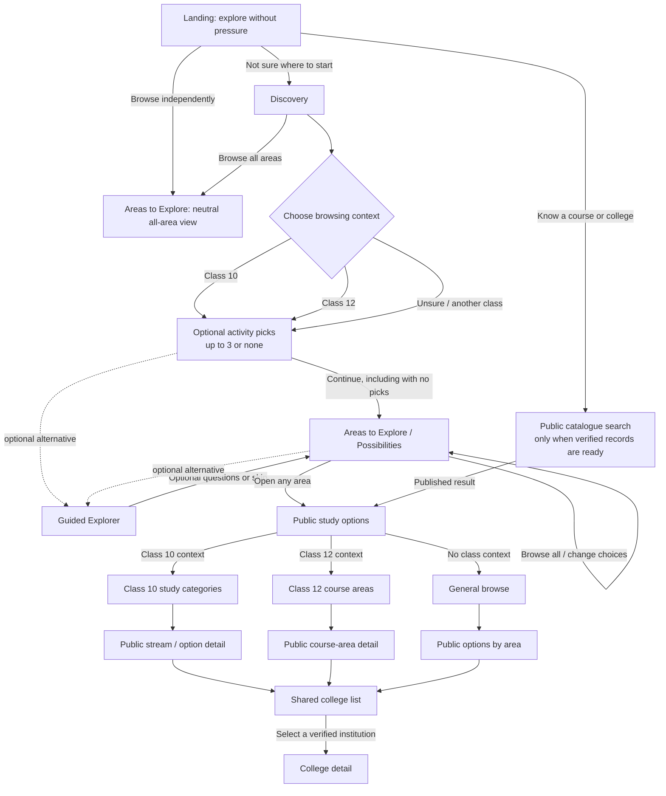
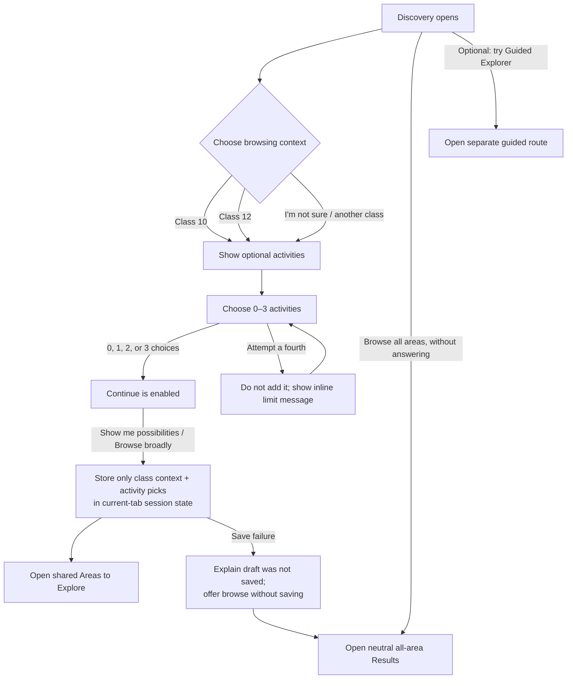
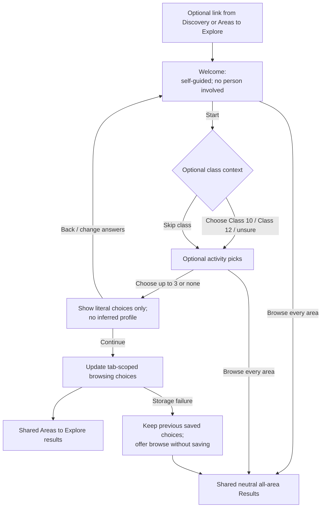
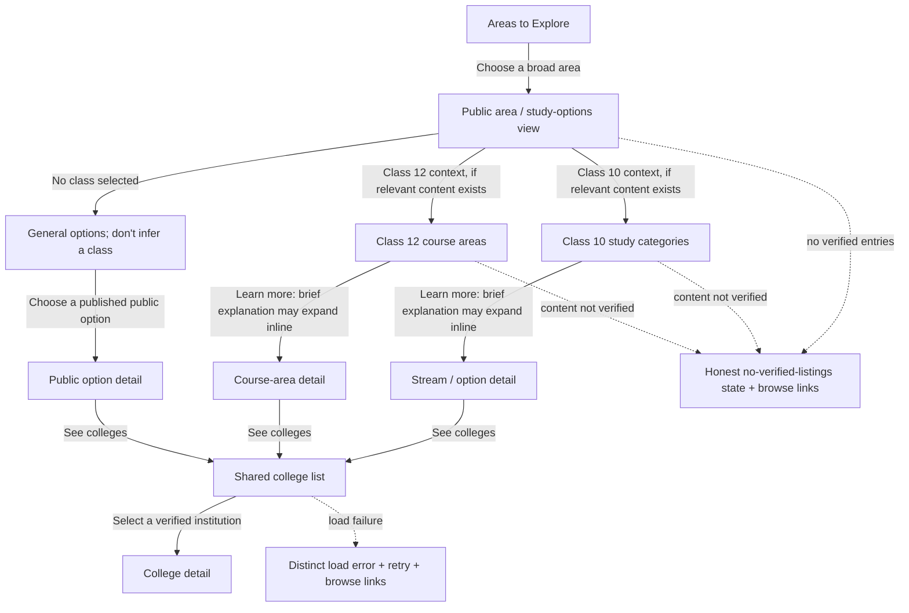
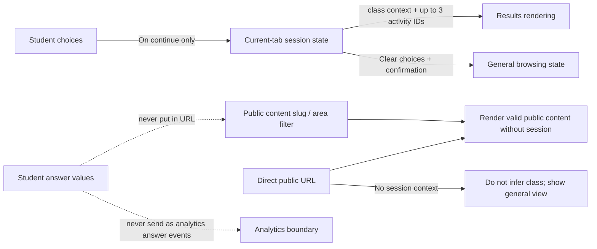
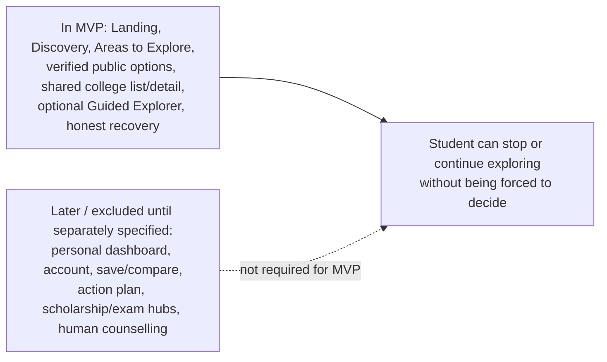

# CareerBridge — User Type 1 MVP Architecture

This document complements [`PLAN_USER_TYPE_1_FINAL.md`](./PLAN_USER_TYPE_1_FINAL.md). The plan defines product requirements; these diagrams show how the screens, branches, shared destinations, state, and recovery paths fit together. They describe the intended product flow—not a deployment or backend architecture.

## 1. Whole student journey

**Principle:** the direct Discovery path continues to Areas to Explore. Guided Explorer is an optional alternative to reach the same broad exploration destination; it is never a required step or an automatic destination for an unsure student. A student can stop at any point, browse all areas, or return to change choices.

## 2. Discovery interaction

The browse-all link is available before the student answers anything. Activity picks are optional. The class context organizes the view; it does not determine eligibility. Do not send answer values in URLs.

## 3. Guided Explorer — optional route to the same results

Guided Explorer drafts remain in memory until the student continues. Leaving before continuing does not replace previously saved choices. Do not add long counselling questionnaires, free-text prompts, sensitive personal questions, or a personalized dashboard to this MVP. “Unsure” never automatically routes a student into Guided Explorer.

## 4. Study options and the shared institution journey

### Choosing inline details versus a separate page

- Keep a useful summary visible on each option card so students can scan and compare without opening multiple overlays.
- Use an inline expansion for a short, stable definition or explanation.
- Use an accessible dialog or mobile bottom sheet for optional context that is longer but self-contained and does not need a new navigable destination.
- Use a separate public page for substantial content, related options, or changing/source-heavy details such as current admissions, eligibility, fees, institution availability, or official references.
- Never hide essential caveats, verification status, deadlines, or sources behind a popup.

### Shared catalogue rules

- Class 10 and Class 12 organize browsing only; neither activity picks nor class context establish eligibility.
- The college list is shared by both branches; do not build duplicate Class 10 and Class 12 college-list experiences.
- Only publish reviewed catalogue records. Unknown facts remain explicitly unknown.
- Distinguish a valid option with no verified listings from an invalid URL and from a catalogue load failure.

## 5. State, public routes, and recovery boundaries

MVP state consists only of the current tab’s class context and activity picks in `sessionStorage`. Do not add account creation, cloud sync, profiles, saves, comparisons, or action plans in this MVP. Browser session restoration can vary. Clearing choices does not erase hosting or analytics logs. Verify actual network requests, analytics, hosting configuration, and logs before making privacy promises.

Every route should support:

- a named, working back action; normal browser Back;
- a distinct **Change my choices** path that preserves choices;
- a separately confirmed **Clear my choices** action;
- direct access to valid public catalogue content without session state;
- neutral browse-all recovery from empty, unavailable, or irrelevant results;
- separate invalid-content, no-verified-listings, and load-failure states.

## 6. MVP boundary

These boundaries preserve a useful, complete exploration journey without implying that deferred features exist or are operational.
