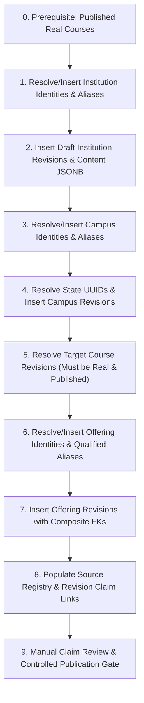

# Independent Review — CareerBridge Institutions Import Readiness

**Review date:** 20 November 2026  
**Auditor:** Antigravity (Independent Clean-Room Review)  
**Target Document:** `docs/review/institutions-import-readiness.md`  
**Reference Context:**
- `docs/review/institutions-catalogue-audit.md`
- `docs/review/institutions-schema-safety-review.md`
- `docs/review/institutions-development-db-verification.md`
- `src/db/schema/catalog.ts`
- `drizzle/0000_initial-schema.sql`
- `src/app/explore/institution-directory/`
- `src/app/explore/institutions/`

---

## 1. Executive Summary & Verdict

### Overall Verdict: Agree with corrections

We **agree** with the primary verdict of `institutions-import-readiness.md`: **CareerBridge is NOT READY for data import or live publication**. 

Specifically, we confirm:
1. **Schema Sufficiency:** The existing Drizzle schema (`src/db/schema/catalog.ts`) and database triggers in `0000_initial-schema.sql` fully accommodate the required institution, multi-campus, offering, and provenance structures without any database migrations or DDL changes.
2. **Data Unreadiness:** The current static source dataset consists of 19 fictional demo institutions, 2 candidate real profiles with 100% unverified claims, and 19 demo BCA offerings referencing `example.com`. None of these records are suitable for real student-facing publication.
3. **Course Precondition:** Real course offerings cannot be published because all 38 course revisions currently in development remain unpublished demo drafts.

However, we **require several essential corrections and additions** regarding database immutability triggers, deterministic UUID divergence for seeded offering identities, offering route slug collisions, and importer idempotency patterns before any importer implementation begins.

---

## 2. Findings Ranked by Severity

### Critical (P0 — Architecture & Data Integrity Blockers)

#### Finding 1: Immutability triggers break naive idempotent `ON CONFLICT DO UPDATE` imports
- **Observation:** The report outlines an 8-step import order and suggests idempotency can be achieved. However, it omits that the PostgreSQL database enforces strict immutability triggers:
  - `prevent_published_revision_update` on `catalog_item_revisions`
  - `prevent_published_typed_revision_update` on `institution_revisions`, `campus_revisions`, `course_revisions`, and `course_offering_revisions`
- **Impact:** Any importer attempting an `ON CONFLICT (id) DO UPDATE` or rewriting published rows will immediately fail with a database exception (`Cannot modify published revision %`).
- **Correction:** The importer design must specify an explicit revision-increment workflow:
  - If a published revision matches the source hash/checksum, skip it (no-op).
  - If content has changed, create a new revision with `revision_number = MAX(revision_number) + 1` in `draft` status; do not update in place.

#### Finding 2: Campus-qualified alias strategy orphans 23 seeded `course_offering` identities
- **Observation:** The development database already contains 44 `course_offering` catalogue identities seeded by `0000_initial-schema.sql`:
  - 21 legacy aliases with `external_context_key = ''`
  - 23 contextual aliases with `external_context_key = '<course-id>'` (e.g. `bca`, `ba`, `bsc`)
  These identities use deterministic UUIDs generated via:
  `md5(concat_ws(chr(31), 'careerbridge.catalog.v1', 'careerbridge', item_type, external_type, external_key, external_context_key))::uuid`
- **Impact:** If the importer unilaterally introduces a new alias format such as `external_context_key = '<course-id>/<campus-id>'` (e.g. `bca/main`), the deterministic formula will generate brand-new UUIDs. This will insert new `catalog_items` and leave the 23 existing seeded identities permanently orphaned with zero revisions.
- **Correction:** The importer specification must define an explicit alias migration and resolution policy:
  - For single-campus institutions where legacy seeds match the main campus, map the existing alias to the offering identity and avoid duplicate item creation.
  - For multi-campus or new variants, establish a clear backward-compatibility mapping that preserves legacy contextless and course-only keys.

#### Finding 3: Target course prerequisite blocker
- **Observation:** In `course_offering_revisions`, the composite foreign key `(course_item_id, course_revision_id)` references `catalog_item_revisions(catalog_item_id, id)`. In development, all 38 course revisions are currently `draft`, `demo`, and `unverified`, with 0 published pointers.
- **Impact:** An offering cannot point to a non-existent or unapproved course revision. Attempting to publish an offering whose underlying course is classified as `demo` or status `draft` violates catalogue integrity.
- **Correction:** Course catalogue publication (`publication_status = 'published'`, `data_classification = 'real'`) must be a strict prerequisite before any real course offering can be imported or published.

---

### High (P1 — Design & Routing Risks)

#### Finding 4: Offering route slug ambiguity
- **Observation:** In static source `institutionCampusOfferings`, all 19 demo records have `slug` set to their parent institution's slug (e.g. `demo-01` has `slug: "eastern-hills-college"`). The dynamic route `/explore/institutions/[slug]?course=bca` resolves offerings by matching `offering.slug === params.slug`.
- **Impact:** In `course_offering_revisions`, `slug` has no unique constraint. If an institution offers multiple courses (e.g. Kohima Science College offering both BA and BSc), having both offering revisions share the institution slug (`kohima-science-college-jotsoma`) means slug-based route lookups will collide unless the route handler joins and filters by both `slug` AND `course_item_id`.
- **Correction:** Importer and reader designs must agree on either:
  1. Composite route resolution: `slug` represents the institution/offering path and must be queried alongside `course_id`.
  2. Distinct offering slugs: e.g. `kohima-science-college-jotsoma-bsc`. If changed, frontend route handling must be updated accordingly.

#### Finding 5: 100% unverified claims across real profile candidates
- **Observation:** Kohima Science College and St. Edmund's College contain 6 profile facts, 6 programme records, and admission descriptions in `src/app/explore/institution-directory/institution-profile-data.ts`. All of these entries are explicitly typed with `verificationStatus: "unverified"`. None has a verified date or checked date.
- **Impact:** The report rightly notes this, but it must be reinforced: importing these records without a dedicated manual curation step will result in unverified data being staged. If an admin or automatic script publishes these revisions, unverified claims will be presented to students.
- **Correction:** The importer must maintain `verification_status = 'unverified'` or `'pending_review'` and `publication_status = 'draft'`. Reader UI components must display explicit unverified badges for any claim lacking a verified source timestamp.

#### Finding 6: Missing database access layer (`src/db/institutions.ts`)
- **Observation:** While `src/db/courses.ts` and `src/db/fields.ts` exist, there is no corresponding reader for institutions, campuses, or offerings. The frontend routes `/explore/institution-directory` and `/explore/institutions` read exclusively from hardcoded static TypeScript arrays.
- **Impact:** Importing rows into Neon currently produces no student-facing change; students will continue seeing static demo data until reader modules and route integrations are implemented.
- **Correction:** Prioritize developing `src/db/institutions.ts` with strict filters (`publication_status = 'published' AND data_classification = 'real'`) alongside the importer.

---

### Medium (P2 — Data Quality & Vocabulary Mismatches)

#### Finding 7: Failing test assertion in existing test suite
- **Observation:** Running `node --test src/app/explore/institution-directory/institution-data.test.mjs` yields 3 passing tests and 1 failing test (`AssertionError: 21 !== 2`).
- **Explanation:** Line 80 of the test expects `institutionProfilePages.length === institutionProfiles.length`. However, `institutionProfilePages` intentionally appends 19 generated demo pages to the 2 authored profiles.
- **Correction:** This is confirmed as a stale test expectation in the static mock test, not a schema failure. It should be corrected during the static-to-database reader migration.

#### Finding 8: Vocabulary mismatch between frontend and database verification status
- **Observation:** The static TypeScript type `VerificationStatus` in `institution-registry.ts` permits `"verified" | "unverified" | "outdated"`. In contrast, the PostgreSQL schema check constraint `catalog_item_revisions_verification_status_check` permits:
  `'not_collected'`, `'unverified'`, `'pending_review'`, `'verified'`, `'partially_verified'`, `'disputed'`, `'unavailable'`, `'stale'`, `'expired'`, `'superseded'`
- **Correction:** The importer must not blindly map `"outdated"`. It must map `"outdated"` to `'stale'` or `'expired'` according to clear business rules.

#### Finding 9: Incomplete authored programme entries
- **Observation:** Of the 6 authored programmes in `institution-profile-data.ts`, 2 entries (Kohima's Honours in Computer Science and Honours in Tenyidie) have no `courseId` at all.
- **Impact:** An offering in `course_offering_revisions` requires a non-null `course_item_id`. Offerings cannot be created for these two programmes until courses are assigned.

---

### Low (P3 — Report Discrepancies)

#### Finding 10: Registry URL count correction
- **Observation:** Section 2, line 42 of `institutions-import-readiness.md` states: *"8 occurrences across 5 unique URLs. Four have checkedOn values; the checked records are sample/demo content."*
- **Correction:** A strict inspection of `institution-registry.ts` shows 8 occurrences across **8 unique URLs** (4 non-demo URLs: Kohima website, Kohima admissions, St. Edmund's website, St. Edmund's principal; and 4 demo URLs: Eastern Hills website, Eastern Hills contact, North Valley website, Sample Computing website). All 4 demo URLs carry `checkedOn` dates; none of the 4 non-demo URLs do.

---

## 3. Source-to-Schema Mapping Verification

| Source Entity & Attribute | Database Target Column / Constraint | Status & Verification |
|---|---|---|
| **Institution** | | |
| `InstitutionRecord.id` / `slug` | `catalog_items` (UUID identity) via `catalog_item_aliases` (`careerbridge`, `institution`, slug, `''`) | **Verified.** Deterministic UUID formula matches initial schema migration. |
| `name` | `catalog_item_revisions.title` | **Verified.** |
| `slug`, `initials`, `type`, `ownership` | `institution_revisions.slug`, `initials`, `institution_type`, `ownership` | **Verified.** Types align with CHECK constraints. `ownership` is nullable in DB. |
| `introduction`, `description` | `catalog_item_revisions.summary` and `description` | **Verified.** |
| Structured facts, notices, documents, fees, scholarships | `institution_revisions.institution_content` (JSONB) | **Verified.** Enforced as valid JSON object by trigger. |
| `isDemo` | `catalog_item_revisions.data_classification` | **Verified.** Must map explicitly to `'demo'` or `'real'`. |
| **Campus** | | |
| `InstitutionCampusRecord.id` (`'main'`) | Separate `catalog_items` identity (`item_type = 'campus'`) | **Verified.** Must use parent-qualified alias `external_key = '<institution-slug>/<campus-id>'` with `external_context_key = ''`. |
| Parent institution relationship | `campus_revisions.institution_item_id` | **Verified.** Trigger `campus_revisions_institution_type_check` ensures target item is an institution. |
| `state` | `campus_revisions.state_id` -> `states(id)` | **Verified.** References normalized Northeast state rows in `states` table. |
| Address, locality, city, district, contact, facilities | `campus_revisions.campus_content` (JSONB) | **Verified.** |
| **Course Offering** | | |
| `InstitutionCampusOffering` identity | `catalog_items` identity (`item_type = 'course_offering'`) | **Verified.** Decoupled from institution profile. |
| Institution & Campus link | `course_offering_revisions.campus_item_id` & `campus_revision_id` | **Verified.** Links to campus revision; institution is reached via campus parent. |
| Course link | `course_offering_revisions.course_item_id` & `course_revision_id` | **Verified.** Composite FK to `catalog_item_revisions`. |
| Fees, duration, study mode, eligibility | `course_offering_revisions.offering_details` (JSONB) | **Verified.** |

---

## 4. Evaluation of Safe Import Order & Idempotency

The 8-step dependency sequence proposed in the readiness report is structurally sound, provided the following precautions are integrated:

### Idempotency Rules:
1. **Identities & Aliases:** Query `catalog_item_aliases` by primary key `(source_system, external_type, external_key, external_context_key)`. If found, reuse existing `catalog_item_id`.
2. **Revisions:** Compare payload hash with the active revision.
   - If identical, take no action.
   - If changed, create a new revision with `revision_number + 1`. Never issue an `UPDATE` statement against a published revision or typed revision table.
3. **Publication Pointer:** Never set `catalog_items.published_revision_id` during automated imports. Pointer updates must be gated by a distinct publication transaction that verifies `data_classification = 'real'`.

---

## 5. Verified Facts vs. Assumptions vs. Recommendations

### Verified Facts
- Existing schema (`src/db/schema/catalog.ts`) and database triggers support institutions, campuses, offerings, and sources without schema changes.
- Development database currently has 21 institution identities, 0 campus identities, 44 offering identities, and 0 typed revisions.
- All 38 existing course revisions in development are `draft` / `demo` / `unverified`.
- Database triggers strictly prohibit `UPDATE` or `DELETE` on published revisions and typed revisions.
- Database pointer validation checks `publication_status = 'published'` but does **not** check `data_classification = 'real'`.
- Static institution source files contain 19 demo institutions, 2 candidate real institutions with 100% unverified claims, and 19 demo BCA offerings using `example.com`.

### Assumptions in Prior Reports
- Prior report assumed offering aliases could simply transition to `<course-id>/<campus-id>` without addressing the 23 existing seeded offering identities in Neon.
- Prior report assumed idempotent imports could be rerun without accounting for the published revision immutability triggers.

### Architectural Recommendations
- **Do not proceed with data import or seeding at this time.**
- Proceed with **importer design and reader implementation** (`src/db/institutions.ts`).
- Require that courses (`ba`, `bsc`, `bca`) be curated and published as `real` before real offerings are imported.
- Define the canonical offering route lookup strategy (composite `slug + course` vs unique slug).
- Keep all imported institution records in `draft` and `unverified` status until manual source evidence is attached.

---

## 6. Conclusion

The repository report `institutions-import-readiness.md` is fundamentally sound in its assessment that data import is **blocked** by source data quality, missing provenance, and course status. With the critical architectural additions documented in this review—specifically regarding database immutability triggers, seeded alias preservation, and route slug disambiguation—importer engineering design may proceed safely. No database migrations, data changes, or production connections are required or recommended.
